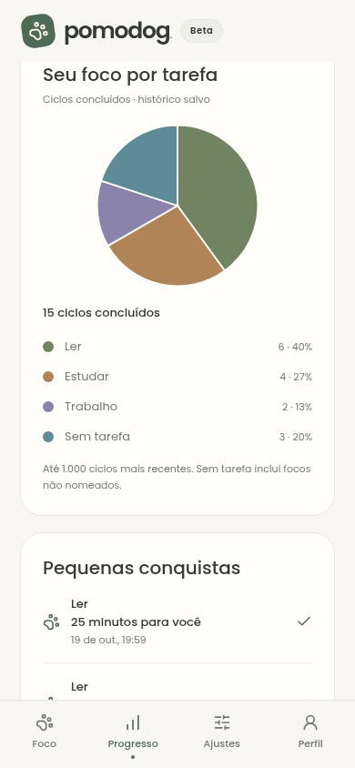

<p align="center">
  
</p>

<h1 align="center">Pomodog</h1>

<p align="center">
  A friendly Pomodoro companion for building a steady focus routine.<br />
  <strong>Beta · Android · Brazilian Portuguese interface</strong>
</p>

## 🐾 Features

- Focus and break sessions with pause, resume and background recovery.
- Nino, an animated dog with gentle encouragement and reduced-motion support.
- Optional tasks, focus streaks and progress charts.
- Android session notifications, countdown controls and a home screen widget.
- Offline use, optional Google sign-in and account synchronization.

Diagnostics and usage analytics are optional and disabled by default.

<p align="center">
  <br />
  <em>Progress preview with sample data.</em>
</p>

Built with Expo, React Native, TypeScript, NativeWind and Firebase.

## 💻 Development

Requires Node.js 24 and npm. Start the web preview:

```sh
npm ci
npm run web
```

For Android, configure JDK 17 and the Android SDK, then connect a device or start an emulator:

```sh
npm run android
```

Use the installed development build instead of Expo Go. For subsequent sessions, run `npm start`. See the [Android setup guide](docs/development-build.md) for details.

## ⚙️ Configuration

Regular local development does not require a `.env` file. Firebase settings are in `src/firebase/client.ts` and `google-services.json`; Google sign-in settings are in `src/google/client.ts`. These currently target the development project. App metadata and native plugins are configured in `app.json`.

| Variable            | Purpose                                                 |
| ------------------- | ------------------------------------------------------- |
| `JAVA_HOME`         | Path to JDK 17 for Android builds.                      |
| `ANDROID_HOME`      | Path to the Android SDK.                                |
| `SENTRY_AUTH_TOKEN` | Optional build secret for uploading Sentry source maps. |

`npm run sentry:upload` reads `SENTRY_AUTH_TOKEN` from the build environment or `.env.sentry-build-plugin` (ignored by Git). Create the latter from `.env.sentry-build-plugin.example` when needed. Keep the token out of commits and `EXPO_PUBLIC_*` variables. See the [Sentry guide](docs/sentry.md).

## ✅ Checks

```sh
npm run typecheck
npm test
npm run format:check
```

## 🗂️ Structure

```text
App.tsx               # Application providers
src/Pomodog.tsx       # Screen composition and navigation
src/features/         # Screens and user flows
src/components/       # Shared UI components
src/domain/           # Business rules
assets/               # Branding and bundled resources
plugins/              # Expo plugins and Android native features
scripts/              # Asset generation and source map uploads
tests/                # Unit tests and Firestore rule checks
docs/                 # Guides, architecture and roadmap
```

## 📚 Documentation

See the [documentation index](docs/README.md) for architecture, configuration, privacy and verification. The [roadmap](docs/plano-de-acao.md) tracks feature status and release work. Detailed guides are in Portuguese.
